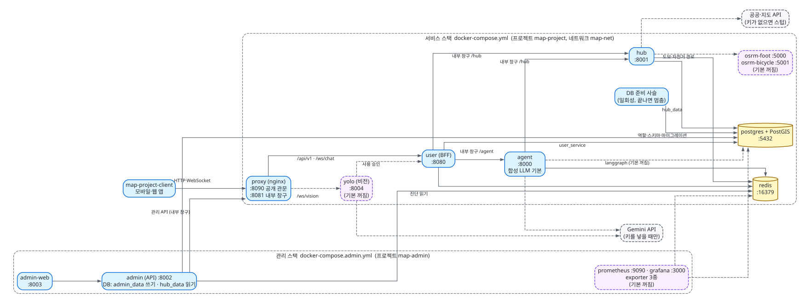

# map-project-infra

MAP 일곱 저장소를 한 기계에서 함께 띄우는 실행 구성(Docker Compose)과 전체 안내. 외부 키 없이 빈 볼륨에서 바로 띄울 수 있다.

## 저장소 지도

MAP 는 일곱 저장소로 이루어져 있다. 전체 구조와 한 번에 실행하는 방법은 [map-project-infra](https://github.com/we-meet-trip/map-project-infra) 에서 시작한다.

| 저장소 | 역할 |
|---|---|
| **[map-project-infra](https://github.com/we-meet-trip/map-project-infra)** | **전체 안내, 로컬 실행 구성(Docker Compose), DB 초기화** |
| [map-project-client](https://github.com/we-meet-trip/map-project-client) | 모바일 앱(Flutter, iOS·Android) |
| [map-project-user](https://github.com/we-meet-trip/map-project-user) | 사용자 BFF(Spring Boot): 인증·일정·채팅·동의, 다른 서비스 중계 |
| [map-project-agent](https://github.com/we-meet-trip/map-project-agent) | 추천 에이전트(FastAPI·LangGraph): 장소·경로·일정 생성 |
| [map-project-hub](https://github.com/we-meet-trip/map-project-hub) | 외부 데이터 게이트웨이(FastAPI·PostGIS): 관광·날씨·장소·경로 |
| [map-project-yolo](https://github.com/we-meet-trip/map-project-yolo) | 비전 서비스(WebSocket, 객체 탐지 + LLM 식별) |
| [map-project-admin](https://github.com/we-meet-trip/map-project-admin) | 운영 콘솔(FastAPI·React) |

## 이름의 뜻

- `map-project` 는 MAP 프로젝트의 공개 저장소 묶음 이름이다. 일곱 저장소가 같은 접두를 쓴다.
- `infra` 는 서비스 코드가 아니라 서비스들을 함께 띄우는 구성(compose·관문·DB 준비)을 갖는 저장소라는 뜻이다.
- 환경변수 접두 `MAP_PROJECT_` 는 여러 서비스가 같은 값을 함께 읽는 값, `USER_`·`AGENT_`·`HUB_`·`YOLO_`·`ADMIN_`·`CLIENT_` 는 그 서비스만 읽는 값이다.

## 개요

MAP 는 여행 일정을 추천하는 앱이다. 사용자가 날짜·이동수단·취향을 고르면 장소와 동선, 시간표를 만들어 주고, 함께 가는 사람과 채팅하고, 카메라로 비춘 대상을 알려 준다. 앱(client) 뒤에 사용자 BFF(user)가 있고, 그 뒤에서 추천 에이전트(agent)와 외부 데이터 게이트웨이(hub), 비전 서비스(yolo)가 일한다. 운영 콘솔(admin)은 따로 뜬다.

이 저장소는 그 서비스들을 형제 디렉터리로 받아 한 번에 빌드해 띄운다. 빈 데이터 볼륨에서 DB 역할·스키마·마이그레이션을 순서대로 만들고, 기본값은 외부 유료 API 를 부르지 않는다(모델은 합성 제공자, 외부 데이터는 스텁).

## 아키텍처

<picture>
  <source media="(prefers-color-scheme: dark)" srcset="docs/diagrams/system-dark.svg">
  
</picture>

점선은 기본으로 꺼진 선택 기능이거나 키를 넣을 때만 부르는 외부 서비스다. 처리 순서와 자격 나누기는 [docs/architecture.md](docs/architecture.md), 그림의 근거는 [docs/diagrams/CLAIMS.md](docs/diagrams/CLAIMS.md) 에 있다.

## 기능

- **두 스택**: 서비스 스택(`docker-compose.yml`)과 관리 스택(`docker-compose.admin.yml`). 포트는 모두 `127.0.0.1` 에만 붙는다.
- **빈 볼륨 빠른 시작**: `scripts/make-local-env.sh` 가 비밀값을 만들고, compose 의 일회성 단계가 DB 를 준비한다. 두 번째 기동부터는 건너뛴다.
- **관문**: nginx 하나가 여는 경로를 목록으로 정하고, 서비스끼리는 내부 창구로 부른다.
- **자격 나누기**: 서비스는 제한된 실행 역할로만 DB 에 붙고, 서비스마다 받는 환경변수를 목록으로 정한다.
- **선택 기능**(기본 꺼짐): 비전(`--profile vision`), 경로 엔진(`--profile routing`), 지표 수집(관리 스택 `--profile monitoring`), HTTPS 앞단 예시(`docker-compose.edge.yml`), 직접 빌드한 이미지 받아 쓰기(`docker-compose.registry.yml`).
- **시험 스택 격리**: `docker-compose.test.yml` 덧칠과 `scripts/compose-isolation-check.sh` 가 시험 스택이 다른 스택의 볼륨·포트·이름을 쓰지 않는지 본다.
- **무중단 교체 도구**(교육용): `scripts/service-rollover.py`·`migration-expand-gate.py`·`zd-probe.py`([docs/decisions/0005](docs/decisions/0005-zero-downtime-rollover.md)).

## 빠른 시작 (외부 키·비용 없이)

필요한 것: Docker(Compose v2), git, openssl, 이미지 빌드에 쓸 디스크 여유(수 GB). macOS(Apple Silicon 포함)·Linux 기준이다.

```sh
# 1) 일곱 저장소를 형제 디렉터리로 받는다(compose 가 ../map-project-<x> 를 빌드한다)
mkdir map && cd map
for r in infra user agent hub yolo admin client; do
  git clone https://github.com/we-meet-trip/map-project-$r
done
cd map-project-infra

# 2) .env 를 만든다 — 비밀번호·토큰·암호 열쇠를 이 기계에서만 쓰는 무작위값으로 채운다
./scripts/make-local-env.sh

# 3) 서비스 스택을 띄운다 — 첫 기동은 이미지 빌드와 DB 준비 단계가 함께 돈다
docker compose --profile full up -d --build

# 4) 확인 — 일회성 단계는 Exited (0), 서비스는 healthy
docker compose --profile full ps -a
curl -s http://127.0.0.1:8090/healthz       # 관문
curl -s http://127.0.0.1:8090/healthz/app   # 관문 → user
```

- 상태 확인 주소: user `http://127.0.0.1:8080/actuator/health`, agent `http://127.0.0.1:8000/health/ready`, hub `http://127.0.0.1:8001/health/ready`.
- 앱은 [map-project-client](https://github.com/we-meet-trip/map-project-client) 의 안내대로 관문 주소(`http://127.0.0.1:8090`, 안드로이드 에뮬레이터는 `http://10.0.2.2:8090`)를 보게 띄운다. 맥에서 단계별로 띄우는 스크립트도 있다(`scripts/map-up-1-backend.sh` → `map-up-2-bff.sh` → `map-up-3-client.sh`, 정리는 `map-down.sh`).
- 관리 스택(선택): `docker compose -f docker-compose.admin.yml up -d --build` → `http://127.0.0.1:8003`. 첫 로그인은 `.env` 의 `ADMIN_BOOTSTRAP_USER`·`ADMIN_BOOTSTRAP_PASSWORD`.
- 정리: `docker compose -f docker-compose.admin.yml down -v` 다음 `docker compose --profile full down -v`(이 프로젝트의 볼륨만 지운다).
- 컨테이너 이름이 `map-project-<서비스>` 로 고정이라 같은 기계에 서비스 스택을 둘 띄울 수 없다.

### 막힐 때

| 보이는 것 | 뜻 | 할 일 |
|---|---|---|
| `MAP_PROJECT_LOCATION_WIRE_KEY … is required` | user·agent·hub 가 나눠 갖는 좌표 봉투 열쇠가 없다 | `./scripts/make-local-env.sh --force`(이미 있는 값은 옮겨 온다) |
| `runtime_role_required`, `migration_secret_in_serving` | user 서빙에 실행 역할이 아닌 자격이 들어갔다 | `.env` 의 `USER_DATABASE_USER=map_user_runtime` 확인 |
| `{"status":"configuration_rejected"}` | user 부트스트랩·마이그레이션 진입점이 허용 밖 환경변수를 봤다 | compose 를 고치지 않았는지 확인(`db/setup/user-bootstrap.sh`) |
| 일회성 단계가 Exited (1) | DB 준비가 멈췄다 | `docker compose logs <단계 이름>` — 새로 시작하려면 `down -v` 뒤 다시 |

## 설정

모든 값의 자리와 설명은 [`.env.example`](.env.example) 에 있다. `.env.example` 의 비밀값 자리는 비어 있고 `make-local-env.sh` 가 채운다.

- **로컬 실행용 기본값이다 — 외부에 열기 전에 반드시 인증(`USER_`/`AGENT_`/`HUB_AUTH_ENFORCED`)을 켜고, 서명 열쇠·토큰을 다시 만들고, CORS 출처(`USER_CORS_ALLOWED_ORIGINS`)를 좁힌다.** 관리 콘솔 쿠키도 `ADMIN_SESSION_COOKIE_SECURE=true` 로 둔다.
- 실제 모델을 쓰려면 `AGENT_LLM_PROVIDER=gemini` 와 `MAP_PROJECT_GEMINI_API_KEY` 를 넣는다. 실제 외부 데이터를 쓰려면 `HUB_PLACES_STUB_MODE=false` 로 바꾸고 hub 의 키(`MAP_PROJECT_KMA_SERVICE_KEY`·`MAP_PROJECT_KAKAO_REST_API_KEY` 등)를 넣는다. 키를 넣는 순간부터 그 발급처의 한도·요금이 적용된다.
- 이름 체계와 공유 비밀값은 [docs/contracts.md](docs/contracts.md).

## 데이터

이 저장소는 데이터를 담지 않는다. 경로 엔진 그래프(OpenStreetMap, ODbL)와 성향 통계 파일의 받는 법·이용조건·한계는 [docs/data.md](docs/data.md).

## API와 계약

각 서비스의 API 는 그 저장소의 문서가 정한다. 이 저장소가 정하는 포트·관문 경로·환경변수 이름·공유 비밀값·이미지 이름은 [docs/contracts.md](docs/contracts.md).

## 폴더 구조

```text
docker-compose.yml            서비스 스택(프로필 infra·backend·full·vision·routing)
docker-compose.admin.yml      관리 스택(monitoring 프로필)
docker-compose.test.yml       시험 스택 덧칠(포트·볼륨·네트워크·이름을 따로)
docker-compose.registry.yml   직접 빌드한 이미지 받아 쓰기(서비스·관리 각각)
docker-compose.edge.yml       HTTPS 앞단 예시(Caddy, example.com 자리표시)
.env.example                  설정 본보기(비밀값 자리는 비어 있다)
db/setup/                     빈 DB 준비 단계(setup.sh, 스키마·관리 콘솔 역할 SQL, user 부트스트랩 감싸기)
proxy/                        nginx 관문 설정, 교체 중 상류 자리(upstreams/)
edge/                         Caddy 설정 예시
monitoring/                   prometheus·grafana 설정
scripts/                      비밀값 생성·로컬 기동·격리 검사·e2e·OSRM 빌드·무중단 교체·다이어그램 렌더
segstats/                     성향 통계 파일을 두는 자리(파일은 담지 않는다)
tests/                        단위 시험(표준 라이브러리, compose 렌더)
docs/                         구조·데이터·계약·트러블슈팅·결정 기록·다이어그램
```

## 테스트

```sh
python3 -m unittest discover -s tests -v       # 단위 시험(외부 네트워크 없음, Docker 가 있으면 compose 렌더 시험도 돈다)
./scripts/make-local-env.sh --force && ./scripts/make-test-env.sh --force
./scripts/compose-isolation-check.sh           # 시험 스택 격리
```

CI(`.github/workflows/ci.yml`)는 파이썬 3.11·3.12·3.13 에서 단위 시험을 돌리고, compose 조합 렌더·관문 설정 문법·격리·본보기 비밀값 자리를 본다. 비밀값과 외부 키를 쓰지 않는다.

시험 스택(`--env-file ./.env.test -f docker-compose.yml -f docker-compose.test.yml`)을 띄운 뒤에는 `BASE=http://127.0.0.1:8290 E2E_PASSWORD=<.env.test 의 USER_TESTER_SEED_PASSWORD> ./scripts/e2e.sh` 로 시험 스택 관문 너머를 훑는다.

## 트러블슈팅과 교훈

[docs/troubleshooting.md](docs/troubleshooting.md) 에 증상·원인·해결·교훈을 모았다. 몇 가지:

- 본보기만 복사하면 서비스가 붙을 DB 역할이 없었다 → 빈 볼륨 준비 사슬(T-INFRA-01). PostGIS 이미지는 첫 부팅에 확장을 깔아 "빈 DB" 를 빈 DB 가 아니게 만든다(T-INFRA-02).
- 상태 확인이 보는 길과 실제 작업이 쓰는 길이 다르면, 상태 확인은 그 고장을 보지 못한다(T-INFRA-04).
- 이름을 합칠지 나눌지는 이름이 아니라 "같은 값을 읽는가" 로 정한다(T-INFRA-16).

설계 결정은 [docs/decisions/](docs/decisions/).

## 한계

- 이 저장소는 이미지를 게시하지 않는다. 받아 쓰기 덧칠은 직접 빌드해 올린 레지스트리를 적어야 한다.
- 비전(yolo)은 모델 키가 필요하고, 경로 엔진은 그래프를 직접 만들어야 한다. 둘 다 기본으로 꺼져 있다.
- 합성 LLM 제공자의 추천은 결정적인 예시 결과다(결과에 synthetic 표시). 실제 추천 품질은 실제 모델에서만 나온다.
- Windows 는 확인하지 않았다.

## 감사 표시

- 다이어그램은 Graphviz 로 그리고 Pretendard 글꼴(SIL OFL 1.1)로 표시한다. 글꼴 파일은 저장소에 넣지 않는다.

## 고지

- 이 저장소는 교육·학습 목적으로 공개한 코드다. 운영 중인 서비스가 아니며 지원을 약속하지 않는다.
- 이 프로젝트는 코드가 연동하는 외부 서비스·데이터 제공자(한국관광공사, 기상청, 공공데이터포털, 국토교통부, 서울특별시, 한국환경공단, 카카오, 네이버, Google, Apple, LangChain, ODsay, OpenStreetMap, Ultralytics, Wikimedia 등)와 관련이 없으며, 그들로부터 승인이나 후원을 받지 않았다. 언급한 상표와 서비스 이름은 각 소유자에게 있다.
- 저장소에는 제3자 데이터·이미지·본문을 넣지 않는다. 예외로, 이용조건을 원문으로 확인한 공공·개방 자료만 출처와 이용조건을 밝혀 담는다(`docs/data.md`). 그 밖의 외부 데이터는 각 제공자의 약관에 따라 직접 받아야 한다.
- MIT 라이선스는 이 저장소의 코드에만 적용된다. 저장소에 담은 공공·개방 자료와 외부 데이터, 모델 가중치, 폰트, 라이브러리는 각자의 이용조건·라이선스를 따른다.

## 라이선스

코드는 [MIT 라이선스](LICENSE)를 따른다. Copyright (c) The MAP Contributors. 만든 사람들은 [AUTHORS.md](AUTHORS.md) 에 있다.
