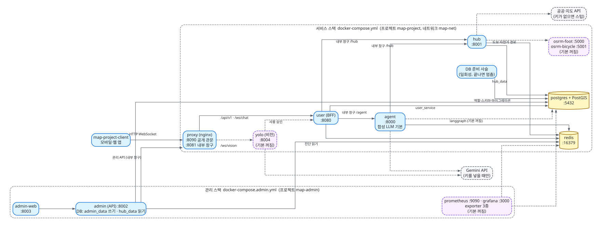

# 구조

이 저장소는 서비스 코드를 갖지 않는다. 일곱 저장소의 서비스를 한 기계에서 함께 띄우는 구성(Docker Compose), 빈 DB 를 서비스가 붙을 수 있는 상태로 만드는 준비 단계, 그리고 그 주변 도구를 갖는다.

<picture>
  <source media="(prefers-color-scheme: dark)" srcset="diagrams/system-dark.svg">
  
</picture>

그림의 모든 노드와 선의 근거는 [diagrams/CLAIMS.md](diagrams/CLAIMS.md) 에 있다.

## 두 스택

| 스택 | 파일 | 프로젝트 이름 | 서비스 |
|---|---|---|---|
| 서비스 | `docker-compose.yml` | `map-project` | postgres · redis · DB 준비 단계 7개 · user · agent · hub · proxy, 선택: yolo · osrm-foot · osrm-bicycle |
| 관리 | `docker-compose.admin.yml` | `map-admin` | admin · admin-web, 선택: prometheus · grafana · exporter 3종 |

- 두 스택은 `map-net` 네트워크를 나눠 쓴다. 서비스 스택이 네트워크를 만들므로 **기동은 서비스 → 관리, 종료는 관리 → 서비스** 순서다.
- 프로필: `infra`(postgres·redis), `backend`(DB 준비 단계·user·agent·hub·proxy), `full`(둘 다), `vision`(yolo), `routing`(OSRM). 관리 스택은 `monitoring`.
- 포트는 모두 `127.0.0.1` 에만 붙는다. 바깥으로 열 때는 관문(proxy) 하나만 연다.
- 컨테이너 이름은 `map-project-<서비스>` 로 고정한다. 그래서 같은 기계에 서비스 스택을 둘 띄울 수 없다(시험 스택 덧칠은 이름 고정을 풀어 함께 띄울 수 있다).

## 처리 순서 — 빈 볼륨 첫 기동

`docker compose --profile full up -d --build` 한 번으로 아래가 순서대로 돈다. 순서는 `depends_on`(`service_completed_successfully`)이 지킨다.

1. **postgres** — 첫 부팅 때 아무 SQL 도 돌리지 않는다. 이미지가 가진 첫 부팅 스크립트 자리를 빈 tmpfs 로 덮는다(`docker-compose.yml` postgres 의 `tmpfs`). user 의 빈 DB 부트스트랩이 확장도 스키마도 없는 DB 를 요구하기 때문이다.
2. **db-user-prepare** (psql) — DB 에 user 부트스트랩 표식을 달고 user 의 준비 SQL 을 건다.
3. **user-db-bootstrap** (user 이미지) — user 스키마의 첫 판을 만든다. 진입점이 정해진 이름 밖의 환경변수를 거절하므로 감싸기 스크립트(`db/setup/user-bootstrap.sh`)가 나머지를 지우고 부른다.
4. **db-user-activate** (psql) — user 의 실행·마이그레이션 로그인을 연다.
5. **user-db-migrate** (user 이미지) — user 마이그레이션.
6. **db-platform** (psql) — PostGIS(필요한 것만 `public` 에), 나머지 스키마(`hub_data`·`langgraph`·`admin_data`), hub·agent 역할 SQL, 관리 콘솔 역할, 지표 수집 역할과 각 로그인 비밀번호. hub 표가 아직 없으면 hub 첫 마이그레이션에 필요한 DB CREATE 권한을 잠시 연다.
7. **hub-db-migrate** (hub 이미지) — hub 마이그레이션. 마이그레이션 자격 하나만 받는다.
8. **db-finish** (psql) — 잠시 연 권한을 거두고 hub·agent 역할 SQL 을 다시 건다. 역할 SQL 은 이미 있는 표에만 권한을 주므로 마이그레이션 뒤에 다시 걸어야 한다.
9. **user·hub** 서빙 기동 → **agent**(hub 시작 뒤) → **proxy**(user 뒤).

두 번째 `up` 부터는 각 단계가 상태를 보고 바로 끝난다(`db/setup/setup.sh` 의 건너뛰기 검사, user 부트스트랩은 준비 단계가 남긴 표식 파일이 있을 때만).

역할 SQL 은 각 서비스 레포의 것(`../map-project-user/scripts/sql/`, `../map-project-hub/scripts/database-roles.sql`, `../map-project-agent/scripts/database-roles.sql`)을 읽기 전용으로 붙인다. 사본을 두지 않는 이유는, 서비스가 표를 바꿀 때 권한 목록도 같이 바뀌는데 사본은 조용히 어긋나기 때문이다.

## 자격 나누기

| 쓰는 곳 | 받는 DB 자격 |
|---|---|
| user·hub·agent 서빙 | 각자의 실행 역할(`map_user_runtime`·`map_hub_runtime`·`map_agent_runtime`)만 |
| user 부트스트랩·마이그레이션 | 그 단계의 로그인만(부트스트랩 로그인, `map_user_migrator`) |
| hub 마이그레이션 | `map_hub_migrator` 접속 문자열 하나만 |
| psql 준비 단계 | DB 운영자(superuser) — 서빙에는 넘기지 않는다 |
| 관리 콘솔 | `map_admin`(`admin_data` 소유, `hub_data` 읽기) |
| 지표 수집 | `map_pg_exporter`(`pg_monitor` 만) |

각 서비스는 섞인 자격을 받으면 기동을 거부한다. 서비스마다 받는 환경변수는 compose 의 `environment:` 목록으로 정하고 `env_file` 은 쓰지 않는다 — 그래야 한 서비스의 비밀값이 다른 서비스로 새지 않는다(`tests/test_service_environment.py`).

## 관문(proxy)

- 공개 관문 `:8090` — `/api/v1/*`·`/ws/chat` 은 user 로, `/ws/vision` 은 yolo 로 넘긴다. 여는 경로를 목록으로 못박고 그 밖은 404, 운영 지표 경로(`/actuator`)는 막는다. 일정 생성에는 주소당 호출 상한을 건다(`proxy/default.conf`).
- 내부 창구 `:8081` — 서비스끼리 부를 때 쓴다(`/user`·`/hub`·`/agent`). 상대를 새 판으로 바꾸는 동안에도 주소가 그대로이고 관문이 바뀐 쪽으로 넘긴다.
- 상류 이름은 요청 때마다 다시 푼다. 상대 컨테이너를 다시 만들 때마다 502 가 나던 문제를 막는다.

## 무중단 교체 도구 (교육용)

`scripts/service-rollover.py` 는 서비스 하나를 요청을 끊지 않고 새 이미지로 바꾼다. 새 이미지로 옆 컨테이너를 띄우고, 상태 확인이 통과하면 관문의 상류를 그쪽으로 돌린 뒤, 정식 컨테이너를 다시 만들고 상류를 되돌린다. `scripts/migration-expand-gate.py` 는 옛 판이 견딜 수 없는 마이그레이션(열 삭제·이름 변경·기본값 없는 필수 열 등)을 거절하고, `scripts/zd-probe.py` 는 교체 동안 공개 경로를 초마다 물어 실패를 센다. 빠른 시작에는 쓰이지 않는다.

## 외부 의존성

| 대상 | 쓰는 곳 | 기본 동작 |
|---|---|---|
| Gemini API | agent·yolo | 부르지 않는다. agent 는 합성 제공자(`AGENT_LLM_PROVIDER=fake`)가 기본, yolo 는 기본으로 꺼져 있다 |
| 공공·지도 API(기상청·한국환경공단·한국관광공사·공공데이터포털·국토교통부·서울특별시·카카오·네이버·Google·ODsay) | hub(관리 콘솔은 상태 점검) | 키가 없으면 부르지 않고 스텁으로 답한다 |
| OSRM | hub | 주소를 채우고 routing 프로필을 켤 때만 |
| 위키백과 | yolo | 연락처(`YOLO_WIKIPEDIA_CONTACT`)를 넣을 때만 |

## 타임아웃과 한도 (compose·본보기 기본값)

| 항목 | 값 | 근거 |
|---|---|---|
| user → hub 일반 요청 / 길찾기 묶음 | 5초 / 20초 | `.env.example` `USER_HUB_TIMEOUT_SECONDS`·`USER_HUB_DIRECTIONS_TIMEOUT_SECONDS` |
| user 가 agent 초안을 기다리는 상한 | 110초 | `USER_TRIP_POLL_TIMEOUT_SECONDS` |
| yolo 모델 식별 / 작업 전체 | 25초 / 45초 | `YOLO_GEMINI_TIMEOUT_SECONDS`·`YOLO_JOB_TIMEOUT_SECONDS` |
| agent 종료 유예 | 320초 | `docker-compose.yml` agent `stop_grace_period` — 진행 중 작업에 실패를 알리고 나갈 시간 |
| 컨테이너 로그 | 10MB × 3벌 | `docker-compose.yml` `x-logging` |
| 메모리 상한 | postgres 1g · redis 256m · user 2g · agent 512m · hub 512m · yolo 3g · proxy 128m · OSRM 각 1g | 각 서비스 `deploy.resources.limits` |
| CPU 상한 | 2코어 서버에서도 만들어지도록 2.0 이하 | 같은 곳 |
